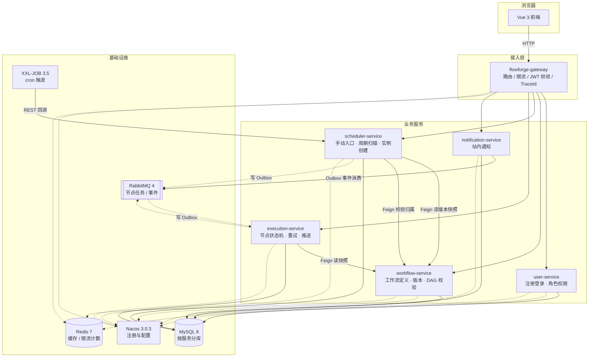
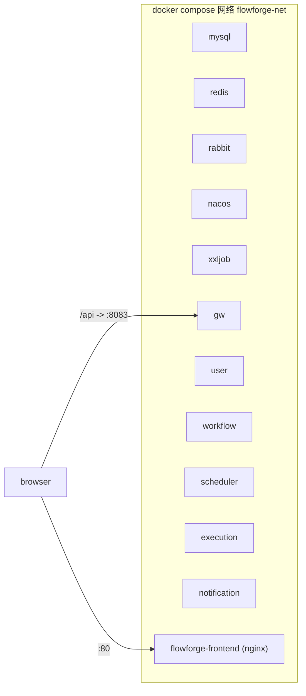

# 02 架构与技术选型

## 1. 架构全景

**读图要点**：业务服务之间的**状态流转**一律走 RabbitMQ，不走同步调用。同步 Feign 只用于"查询定义"这类无副作用的读操作，避免服务间形成同步调用链。

## 2. 服务职责与调用关系

### 2.1 服务边界

| 服务 | 拥有的数据 | 对外提供 | 依赖 |
| --- | --- | --- | --- |
| gateway | 无 | 统一入口 | Nacos、Redis（限流） |
| user-service | 用户、角色 | 登录、JWT、资料、权限 | MySQL、Redis |
| workflow-service | 工作流定义、版本、节点、边 | 定义 CRUD、校验、发布、快照查询 | MySQL |
| scheduler-service | 周期任务、调度记录 | 手动执行、cron 配置、到期扫描 | MySQL、Feign(workflow) |
| execution-service | 执行实例、节点执行、尝试、事件、Outbox | 执行详情查询、取消、手动重试 | MySQL、RabbitMQ、Feign(workflow) |
| notification-service | 通知记录、投递记录 | 通知查询、已读 | MySQL、RabbitMQ |

### 2.2 同步调用清单

| 调用方 | 被调用方 | 用途 | 超时 | 熔断 | 是否重试 |
| --- | --- | --- | --- | --- | --- |
| gateway | user-service | `/auth/**` 路由 | 3s | 否 | 否 |
| scheduler | workflow-service | 读取版本快照、校验归属 | 2s / 1s | 是 | 读操作可重试 1 次 |
| execution | workflow-service | 读取版本快照（本地缓存兜底） | 2s / 1s | 是 | 读操作可重试 1 次 |

**规则**：写操作一律不配置 Feign 自动重试，避免重复创建。

### 2.3 异步事件清单

| 事件 | 生产方 | 消费方 | 用途 |
| --- | --- | --- | --- |
| `node.ready` | execution | execution | 投递一个可执行节点 |
| `node.retry` | execution | execution | 延迟到期的重试 |
| `workflow.finished` | execution | notification | 工作流终态通知 |
| `node.failed_permanently` | execution | notification | 节点永久失败告警 |

具体拓扑见 [05-消息设计与可靠性](05-消息设计与可靠性.md)。

## 3. 技术栈与版本矩阵

> 版本于 2026-10 从 Maven Central / npm registry 实测核实，全部为**已发布稳定版**，不使用快照或预览版。

### 3.1 后端

| 类别 | 组件 | 版本 | 选型依据 |
| --- | --- | --- | --- |
| JDK | Eclipse Temurin | **21 (LTS)** | 提示词要求；虚拟线程可用但不强依赖 |
| 构建 | Maven | 3.9.x + Wrapper | 多模块聚合 |
| 基础框架 | Spring Boot | **3.5.16** | 3.x 线的最后一个维护补丁版本 |
| 微服务 | Spring Cloud | **2025.0.3** | 官方对应 Boot 3.5.x |
| 微服务 | Spring Cloud Alibaba | **2025.0.0.0** | 其父 BOM 为 `spring-cloud-dependencies-parent 4.3.0`，即 SC 2025.0.x 线 |
| 注册配置 | Nacos Server | **3.0.3** | 与 SCA 2025.0.0.0 内置 `nacos-client 3.0.3` 严格对齐 |
| 持久层 | MyBatis-Plus | **3.5.18.1**（`mybatis-plus-spring-boot3-starter`） | 分页、条件构造器、乐观锁插件 |
| 数据库 | MySQL | **8.0**（镜像 `mysql:8.0`） | 事务、唯一约束、行锁是并发设计的基础 |
| 缓存 | Redis | **7**（镜像 `redis:7-alpine`） | 限流计数、热点缓存 |
| 消息 | RabbitMQ | **4.1**（镜像 `rabbitmq:4.1-management`） | Spring AMQP 3.2 起支持 4.x |
| 调度 | XXL-JOB | **3.5.0** | 支持 JDK 17+、Spring Boot 3 |
| 容错 | Resilience4j | **2.4.0** | 与 Spring Cloud CircuitBreaker 兼容 |
| 安全 | Spring Security + JJWT | **0.12.7** | Spring Security 6.5（随 Boot 3.5） |
| 文档 | Springdoc OpenAPI | **2.10.0** | 2.x 面向 Boot 3；3.x 面向 Boot 4，**不能用** |
| 测试 | Testcontainers | **1.21.4** | MySQL / RabbitMQ / Redis 容器化集成测试 |

### 3.2 前端

| 组件 | 版本策略 |
| --- | --- |
| Vue | 3.5.x |
| TypeScript | 5.9 / 6.x 稳定线 |
| Vite | 8.x |
| Element Plus | 2.14.x |
| Pinia | 随 Vue 3 的兼容版本（阶段五锁定） |
| Vue Router | 随 Vue 3 的兼容版本（阶段五锁定） |
| Axios | 1.x |

前端具体补丁版本在**阶段五开始时**结合 Node 版本与各包 peerDependencies 锁定，避免在阶段一只改 package.json 而无法验证。选择原则同上：稳定线，不追预览版。

### 3.3 基础设施镜像

| 组件 | 镜像 | 端口映射 |
| --- | --- | --- |
| MySQL | `mysql:8.0` | 3307→3306（避开本机 3306） |
| Redis | `redis:7-alpine` | 6380→6379 |
| RabbitMQ | `rabbitmq:4.1-management` | 5673→5672，15673→15672 |
| Nacos | `nacos/nacos-server:v3.0.3` | 8848 / 9848 / 8080 |
| XXL-JOB Admin | 本地构建镜像（基于官方 3.5.0 源码） | 8081→8080 |

## 4. 关键选型说明

### 4.1 为什么是 Boot 3.5 + SC 2025.0，不是 Boot 4

提示词要求 Spring Boot 3.x。且 `spring-cloud-alibaba-dependencies:2025.0.0.0` 的父 BOM 为 `spring-cloud-dependencies-parent:4.3.0`，对应 SC 2025.0.x，官方支持 Boot 3.5.x。若升级到 Boot 4，需要 SCA 2025.1.x，超出提示词给定的技术栈范围。

### 4.2 为什么 Nacos 用 3.0.3

SCA 2025.0.0.0 的 BOM 中 `nacos.client.version=3.0.3`。Nacos 客户端与服务端大版本需要匹配，因此服务端固定 `v3.0.3`，不在 BOM 之外单独覆盖客户端版本。

Nacos 3.x 与 2.x 的差异（阶段二实测）：

- **启动脚本强制要求** `NACOS_AUTH_TOKEN`（base64，≥32 字节）与 `NACOS_AUTH_IDENTITY_KEY/VALUE`，即使 `NACOS_AUTH_ENABLE=false` 也缺一不可，否则容器以 `exit 255` 反复重启。
- **不再自动创建内置账户**，默认的 `nacos/nacos` 登录会返回 `User not found`。本地开发因此关闭鉴权（`NACOS_AUTH_ENABLE=false`），生产需单独初始化管理员。
- 控制台独立到 8080 端口（宿主机映射 8849），8848 只保留客户端 API；v1 管理接口已废弃（返回 410），v3 管理接口在关闭鉴权后仍要求账户，因此**服务注册是否成功以客户端日志与网关的实际调用为准**，不以管理 API 为准。

### 4.3 为什么用 XXL-JOB 而不是 Spring `@Scheduled`

`@Scheduled` 在多实例部署下是**每个实例各跑一次**，需要额外加锁才能防重复；XXL-JOB 自带执行器注册、路由策略与故障转移。即便如此，本项目仍不假设"调度框架保证只触发一次"——真正的防重复由数据库唯一键兜底（见 06 文档场景 2）。

### 4.4 为什么任务分发用 RabbitMQ 而不是 Kafka

单个节点任务的消费需要**逐条 ACK + 延迟重试 + 死信**，RabbitMQ 原生支持；Kafka 的延迟重试需要自建多级 topic，反而增加复杂度。本项目消息量级小、可靠性要求高，选 RabbitMQ。

### 4.5 刻意不引入的组件

| 组件 | 不引入的理由 |
| --- | --- |
| Seata / XA 分布式事务 | 跨服务一致性用「本地事务 + Outbox + 消费幂等」解决，引入协调者只会增加故障面 |
| Sentinel | 限流在 Gateway 用 Redis 令牌桶即可；服务级容错用 Resilience4j。不做流量治理大而全 |
| Kafka | 见 4.4 |
| Elasticsearch | 执行记录量级在百万以内，MySQL 索引足够；引入 ES 属于为技术而技术 |
| Prometheus + Grafana | 阶段六有余力再补，第一阶段不承诺 |
| 前端拖拽式流程设计器 | 与设计目标无关，表单 + 依赖表同样能表达 DAG |

## 5. 网关职责边界

网关做三件事，**不做业务鉴权**：

1. `TraceId` 注入：无 `X-Trace-Id` 时生成，向下游透传，日志与响应头回填。
2. JWT 签名与过期校验：无效直接 401，通过后把 `X-User-Id`、`X-User-Roles` 透传给下游。
3. 限流：基于 Redis 的令牌桶，按用户维度限流。

业务服务**必须重新解析身份头并校验资源归属**。攻击者若能绕过网关直连服务端口（容器网络内），服务自身仍要拒绝越权请求。安全组/网络隔离只是额外一层，不能替代代码里的校验。

## 6. 部署拓扑

- 服务之间通过**容器服务名**通信，不硬编码 IP。
- 配置文件区分 `local`（本机 IDE 启动，连接 `localhost:3307` 等映射端口）与 `docker`（容器内，连接服务名）。
- 启动顺序由 `depends_on` + healthcheck 保证：MySQL / Redis / RabbitMQ / Nacos 健康后再启动业务服务；Nacos 健康后再注册。

## 7. 横切能力

| 能力 | 实现方式 |
| --- | --- |
| 统一响应 | `flowforge-common` 提供 `ApiResponse<T>` 与错误码枚举 |
| 统一异常 | `@RestControllerAdvice` 全局捕获，业务异常映射错误码 |
| 参数校验 | Bean Validation，Controller 层只做 DTO 到 Service 的传递 |
| 链路追踪 | `X-Trace-Id` MDC 透传，日志格式统一输出 `traceId` |
| 脱敏 | 日志与消息载荷统一经 `SensitiveDataMasker` 处理 |
| 审计 | 关键状态变更写 `execution_event` |

`flowforge-common` 只放**技术性**内容（响应模型、异常基类、错误码、工具）。业务实体、Mapper、Service 一律下沉到各自服务，防止公共模块变成事实上的"共享数据库"。
