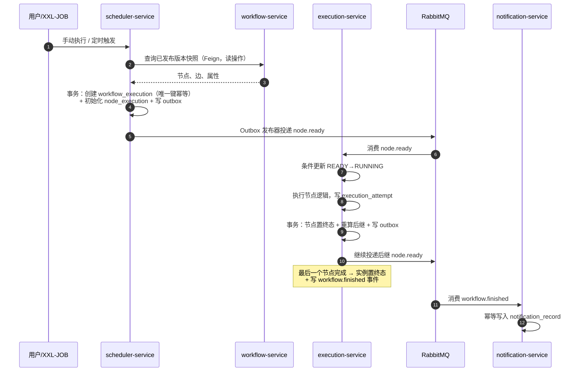
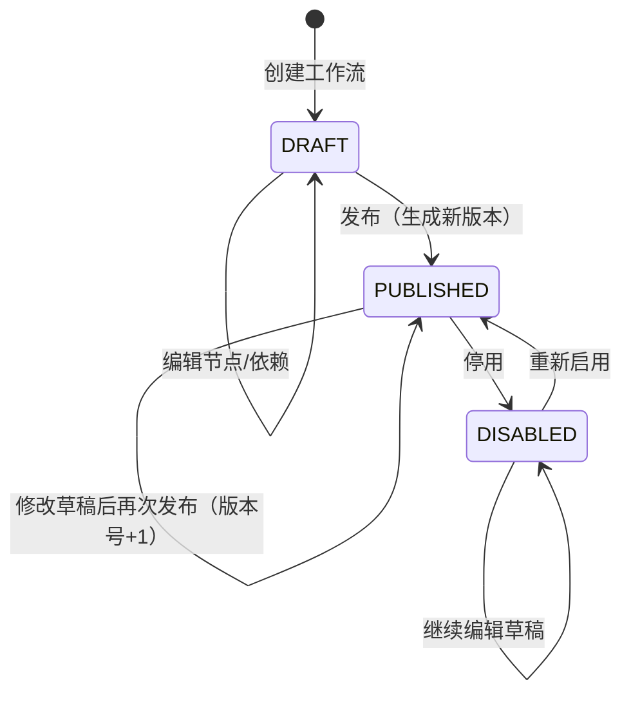
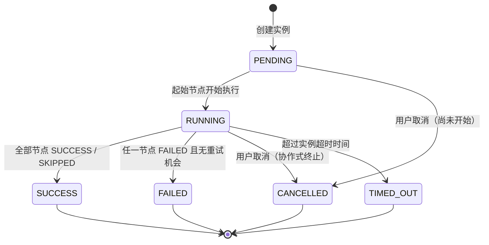
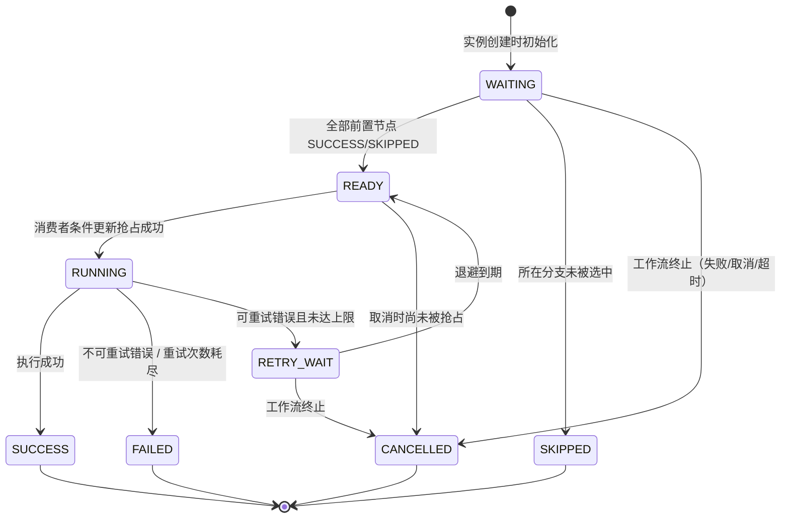

# 03 业务流程与状态机

本文件定义 FlowForge 的全部状态与合法迁移。**所有状态判断以本文件为准，代码中不允许出现绕过状态机的布尔字段判断**（例如用 `is_finished`、`is_failed` 之类的分散标志表示状态）。

## 1. 主执行流程



关键约束：

1. **版本快照只在实例创建时读取一次**，之后执行服务不再回查工作流服务。执行过程中工作流被修改或重新发布，不影响在途实例。
2. **每一步的状态变更都落在数据库**，消息只是"触发器"，不承载权威状态。消息丢失可由对账扫描补齐，消息重复由幂等吸收。
3. **实例创建、节点推进、通知生成三处都使用唯一约束**，这是防重复的最后一道防线。

## 2. 工作流定义状态机



| 迁移 | 触发 | 校验 |
| --- | --- | --- |
| DRAFT → PUBLISHED | 用户点击发布 | DAG 校验全部通过；至少一个节点 |
| PUBLISHED → DISABLED | 用户点击停用 | 仅影响**新的**触发，在途实例不受影响 |
| DISABLED → PUBLISHED | 用户点击启用 | 当前版本仍存在且未被删除 |

**编辑语义**：工作流有"当前草稿"与"已发布版本"两套内容。发布动作把当前草稿固化成一个 `workflow_version` 快照（节点、边、配置全部复制），草稿可以继续编辑，不影响已发布版本。

## 3. 工作流执行实例状态机



| 状态 | 含义 | 是否终态 |
| --- | --- | --- |
| `PENDING` | 实例已创建，尚未有任何节点开始 | 否 |
| `RUNNING` | 至少一个节点已进入 RUNNING | 否 |
| `SUCCESS` | 所有节点终态，且无 FAILED / CANCELLED | 是 |
| `FAILED` | 存在节点永久失败（重试耗尽的 FAILED） | 是 |
| `CANCELLED` | 用户主动取消 | 是 |
| `TIMED_OUT` | 超过实例级超时 | 是 |

**终态不可逆**：任何终态实例不再接受状态变更，手动重试失败节点是创建**新的执行实例**（`trigger_type=MANUAL_RETRY`，`trigger_key` 由前端生成新的幂等键），而不是把旧实例拉回 RUNNING。

## 4. 节点执行状态机



| 状态 | 含义 | 是否终态 |
| --- | --- | --- |
| `WAITING` | 等待前置节点完成 | 否 |
| `READY` | 前置已满足，等待消费者抢占 | 否 |
| `RUNNING` | 正在执行 | 否 |
| `RETRY_WAIT` | 失败后等待退避到期 | 否 |
| `SUCCESS` | 执行成功 | 是 |
| `FAILED` | 永久失败 | 是 |
| `SKIPPED` | 条件分支未选中 | 是 |
| `CANCELLED` | 工作流终止导致未执行 | 是 |

### 4.1 READY 判定规则

节点 `n` 可以从 `WAITING` 进入 `READY`，当且仅当：

```
n 没有前置节点                                    // 起始节点
∨ (n 的所有前置节点状态 ∈ {SUCCESS, SKIPPED})      // 全部前置已完成且无失败
```

前置节点中出现 `FAILED` 或 `CANCELLED` 时，当前节点**不会**进入 READY。此时由失败节点触发**终止传播**：沿其可达下游把所有非终态节点置为 `CANCELLED`，使其进入终态并计入实例的完成计数。不这样做的话，这些节点会永远停在 `WAITING`，实例永远等不到"全部终态"。

### 4.2 状态迁移必须使用条件更新

所有迁移都是带前置状态条件的 UPDATE，不能先查后改：

```sql
UPDATE node_execution
   SET status = 'RUNNING',
       started_at = NOW(3),
       version = version + 1,
       updated_at = NOW(3)
 WHERE id = ?
   AND status = 'READY'
   AND version = ?;
```

影响行数为 `0` → 说明已被其他消费者抢占、或状态已变化，本次消息直接 ACK 丢弃（记录 debug 日志），**不重试、不报错**。这是并发消费幂等的核心。

### 4.3 尝试记录与节点状态的关系

- 每次真正发起执行（含重试）新增一条 `execution_attempt`，`attempt_no` 从 1 递增，唯一键 `(node_execution_id, attempt_no)`。
- `node_execution.retry_count` 表示**已经发生的重试次数**，首次执行不计入重试。
- 进入 `RETRY_WAIT` 时计算 `next_retry_at`，`retry_count + 1`。

## 5. 条件分支与 SKIPPED 传播

### 5.1 条件节点语义

条件节点有且只有两条出边，分别标注 `condition = TRUE` / `condition = FALSE`，执行完成后输出布尔结果。**未选中的那条出边视为"断裂"**，沿其可达的节点不应被执行。

### 5.2 采用全局重算，而不是增量传播

条件分支的跳过逻辑有两种实现方式：

| 方案 | 做法 | 问题 |
| --- | --- | --- |
| 增量传播 | 从断裂边出发 BFS，把下游节点逐个置 SKIPPED，遇到汇合点停止 | 汇合点判定依赖"另一条分支是否还会汇入"，需要维护复杂的入边计数，边界情况多 |
| **全局重算（采用）** | 每次有节点完成后，基于「已选中的边集合」重新计算从起始节点出发的可达集合 | 每次遍历全图，节点数 < 100 时开销可忽略；规则单一，没有增量状态可出错 |

全局重算算法：

```
selectedEdges = { 非条件边 } ∪ { 条件节点已执行且被选中的条件边 }
selectedEdges 中，条件节点尚未执行的出边暂时视为"可通行"
reachable = 从所有入度为 0 的节点出发，沿 selectedEdges BFS 得到的节点集合

对每个节点 n：
  若 n.status = WAITING 且 n ∉ reachable  →  n.status = SKIPPED
```

这样，无论条件嵌套几层、汇合点有几个，规则都一致：**不可达即跳过**。

### 5.3 汇合节点

汇合节点（多条入边）不需要特殊处理：

- 一条入边所在分支被跳过 → 该入边永不产生 SUCCESS，但可达性计算已经能判断整个节点是否可达；
- 若汇合节点仍然可达（另一条分支汇入），它的 READY 判定只会等待"实际可达"的前置节点。

实现上，READY 判定只统计**可达前置节点**：不可达的前置节点会被置为 `SKIPPED`，因此仍满足"所有前置 ∈ {SUCCESS, SKIPPED}"。

### 5.4 分支必须闭合

DAG 校验规则补充一条：**条件节点的两条出边最终必须汇合到同一个节点，或者分别到达结束**。悬空的分支会导致部分节点永远不可达，发布前即拒绝。

## 6. 重试策略

### 6.1 退避公式

```
delay = min(maxDelay, initialDelay × 2^retryCount)
```

- `retryCount` 从 0 开始：第 1 次重试等待 `initialDelay`，第 2 次 `2×initialDelay`，依此类推。
- 可选加入 ±20% 抖动，避免同一批失败节点在同一时刻集中重试。
- `retryCount ≥ maxRetry` 时不再重试，节点置 `FAILED`。

### 6.2 错误分类

| 错误类别 | 示例 | 是否重试 |
| --- | --- | --- |
| 连接失败 | 连接被拒绝、DNS 失败 | 是 |
| 服务端错误 | HTTP 5xx、429 | 是 |
| 业务校验错误 | HTTP 4xx（非 429） | **否**，直接 FAILED |
| 配置错误 | 节点配置非法、URL 格式错误 | **否** |
| 结果未知 | 请求已发出但读超时 | 按策略处理，见下 |

### 6.3 超时后的"结果未知"

调用外部接口后读超时，无法判断对端是否已经完成操作。第一版的策略：

1. 错误码记为 `HTTP_RESULT_UNKNOWN`，尝试记录中标记 `uncertain=true`。
2. 默认**不自动重试**，节点直接 FAILED，通知中明确提示"结果未知，请人工确认"。
3. 若节点配置显式开启 `retryOnUncertain=true`，则自动重试，但必须在请求头携带幂等键 `Idempotency-Key: {executionId}:{nodeKey}`，由对端负责去重。
4. 手动重试时同样携带该幂等键。

这条策略的意义是：宁可停下来让人确认，也不假装"重试一定安全"。

## 7. 取消语义

取消是**协作式**的，不是强杀：

| 场景 | 行为 |
| --- | --- |
| 实例 `PENDING` | 直接置 `CANCELLED`，节点全部 `CANCELLED` |
| 实例 `RUNNING` | 置 `cancel_requested=1`（记录意图），`RUNNING` 中的节点允许执行完毕，但**不再推进新节点**；节点完成后整实例判定为 `CANCELLED` |
| 节点 `READY` 未被抢占 | 直接置 `CANCELLED` |
| 节点 `RETRY_WAIT` | 置 `CANCELLED`，取消延迟消息 |
| 终态实例 | 返回 `409`，不允许取消 |

取消意图单独存字段而不是直接改状态，是因为"请求取消"和"已经取消"是两件事，前者不改变正在执行节点的状态机。

## 8. 超时

| 层级 | 判定者 | 触发方式 |
| --- | --- | --- |
| 节点执行超时 | execution-service | 节点执行时设置 `timeout_ms`，本地超时中断 HTTP 调用 |
| 实例总超时 | **对账扫描器**（每秒一次） | 扫描 `status=RUNNING AND deadline_at < NOW()` 的实例，置 `TIMED_OUT`，未完成节点置 `CANCELLED` |

实例超时不依赖内存计时器，因为进程崩溃后内存计时器就消失了。**只有数据库里的 `deadline_at` 是可信的**。

## 9. 状态机与代码结构的对应关系

| 组件 | 职责 |
| --- | --- |
| `ExecutionStateMachine` | 定义合法迁移表，任何迁移前先断言合法性 |
| `NodeStateMachine` | 同上 |
| Mapper 条件更新方法 | 每个迁移对应一个带前置状态条件的 UPDATE |
| 迁移失败处理 | 影响行数为 0 → 视为并发冲突，重新读取当前状态并决定下一步（ACK 或跳过） |

不引入状态机框架（如 Spring StateMachine），因为本项目状态与迁移数量有限，一个显式的枚举 + 迁移表比框架更直观、可测。
