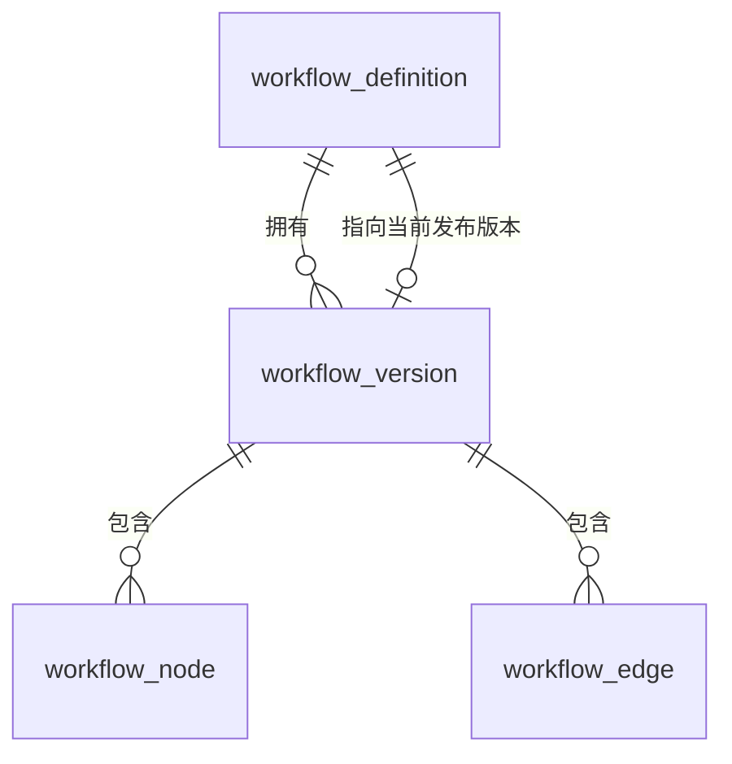

# 04 数据库设计

## 1. 分库原则

第一版共用一个 MySQL 8 实例，但**按服务划分独立 schema**：

| schema | 归属服务 |
| --- | --- |
| `flowforge_user` | user-service |
| `flowforge_workflow` | workflow-service |
| `flowforge_scheduler` | scheduler-service |
| `flowforge_execution` | execution-service |
| `flowforge_notification` | notification-service |

规则：

1. 服务只读写自己的 schema，**禁止跨库 JOIN、禁止跨库事务**。
2. 服务间需要对方数据时，走 Feign 查询或消费事件，不直连对方表。
3. 第一版用"独立 schema + 独立账号"模拟边界，成本低且在 `docker/init` 阶段就能落地。

通用约定：`utf8mb4` / `utf8mb4_0900_ai_ci`；时间统一 `DATETIME(3)`（毫秒精度足够区分重试与调度时刻）；所有表 `InnoDB`。

## 2. 用户服务 `flowforge_user`

### 2.1 sys_user

```sql
CREATE TABLE sys_user (
  id              BIGINT UNSIGNED NOT NULL AUTO_INCREMENT,
  username        VARCHAR(64)  NOT NULL COMMENT '登录名，全局唯一',
  password_hash   VARCHAR(100) NOT NULL COMMENT 'BCrypt 自适应哈希',
  display_name    VARCHAR(64)  NOT NULL,
  email           VARCHAR(128) DEFAULT NULL,
  status          TINYINT      NOT NULL DEFAULT 1 COMMENT '1=正常 0=禁用',
  failed_attempts INT          NOT NULL DEFAULT 0 COMMENT '连续登录失败次数',
  locked_until    DATETIME(3)  DEFAULT NULL COMMENT '锁定截止时间',
  last_login_at   DATETIME(3)  DEFAULT NULL,
  created_at      DATETIME(3)  NOT NULL DEFAULT CURRENT_TIMESTAMP(3),
  updated_at      DATETIME(3)  NOT NULL DEFAULT CURRENT_TIMESTAMP(3) ON UPDATE CURRENT_TIMESTAMP(3),
  PRIMARY KEY (id),
  UNIQUE KEY uk_username (username),
  UNIQUE KEY uk_email (email)
) ENGINE=InnoDB DEFAULT CHARSET=utf8mb4 COLLATE=utf8mb4_0900_ai_ci;
```

- 用户表**不做软删除**：删除用户会破坏执行记录的归属关系和历史可读性，改用 `status=0` 禁用。
- `email` 允许 NULL 且建唯一索引——MySQL 唯一索引允许多个 NULL，不会互相冲突。
- 登录失败计数落库而非只放 Redis：Redis 只做限流加速，锁定状态必须能从数据库恢复。

### 2.2 sys_role / sys_user_role

```sql
CREATE TABLE sys_role (
  id          BIGINT UNSIGNED NOT NULL AUTO_INCREMENT,
  role_code   VARCHAR(32) NOT NULL COMMENT 'ADMIN / USER',
  role_name   VARCHAR(64) NOT NULL,
  created_at  DATETIME(3) NOT NULL DEFAULT CURRENT_TIMESTAMP(3),
  PRIMARY KEY (id),
  UNIQUE KEY uk_role_code (role_code)
) ENGINE=InnoDB DEFAULT CHARSET=utf8mb4 COLLATE=utf8mb4_0900_ai_ci;

CREATE TABLE sys_user_role (
  id         BIGINT UNSIGNED NOT NULL AUTO_INCREMENT,
  user_id    BIGINT UNSIGNED NOT NULL,
  role_id    BIGINT UNSIGNED NOT NULL,
  created_at DATETIME(3) NOT NULL DEFAULT CURRENT_TIMESTAMP(3),
  PRIMARY KEY (id),
  UNIQUE KEY uk_user_role (user_id, role_id),
  KEY idx_role (role_id)
) ENGINE=InnoDB DEFAULT CHARSET=utf8mb4 COLLATE=utf8mb4_0900_ai_ci;
```

`(user_id, role_id)` 唯一，防止同一角色被重复授予导致权限判断出现重复项。

## 3. 工作流服务 `flowforge_workflow`

### 3.1 表关系



### 3.2 workflow_definition

```sql
CREATE TABLE workflow_definition (
  id               BIGINT UNSIGNED NOT NULL AUTO_INCREMENT,
  owner_id         BIGINT UNSIGNED NOT NULL COMMENT '所属用户',
  name             VARCHAR(64)  NOT NULL,
  description      VARCHAR(512) DEFAULT NULL,
  status           VARCHAR(16)  NOT NULL DEFAULT 'DRAFT' COMMENT 'DRAFT/PUBLISHED/DISABLED',
  current_version_id BIGINT UNSIGNED DEFAULT NULL COMMENT '当前生效的发布版本',
  latest_version_no  INT          NOT NULL DEFAULT 0 COMMENT '已发布的最大版本号，0=从未发布',
  created_at       DATETIME(3) NOT NULL DEFAULT CURRENT_TIMESTAMP(3),
  updated_at       DATETIME(3) NOT NULL DEFAULT CURRENT_TIMESTAMP(3) ON UPDATE CURRENT_TIMESTAMP(3),
  PRIMARY KEY (id),
  UNIQUE KEY uk_owner_name (owner_id, name),
  KEY idx_owner_status (owner_id, status)
) ENGINE=InnoDB DEFAULT CHARSET=utf8mb4 COLLATE=utf8mb4_0900_ai_ci;
```

- `uk_owner_name`：同一用户下工作流重名直接拒绝，避免列表页出现两个"每日同步"。
- 只有 `DRAFT` 状态允许编辑节点与依赖；`PUBLISHED` / `DISABLED` 的编辑发生在草稿版本上。

### 3.3 workflow_version

```sql
CREATE TABLE workflow_version (
  id            BIGINT UNSIGNED NOT NULL AUTO_INCREMENT,
  workflow_id   BIGINT UNSIGNED NOT NULL,
  version_no    INT          NOT NULL COMMENT '0=当前草稿；≥1 为发布版本',
  status        VARCHAR(16)  NOT NULL COMMENT 'DRAFT / PUBLISHED / ARCHIVED',
  content_hash  CHAR(64)     DEFAULT NULL COMMENT '发布内容 SHA-256，用于提示“内容未变更”',
  published_at  DATETIME(3)  DEFAULT NULL,
  published_by  BIGINT UNSIGNED DEFAULT NULL,
  created_at    DATETIME(3)  NOT NULL DEFAULT CURRENT_TIMESTAMP(3),
  updated_at    DATETIME(3)  NOT NULL DEFAULT CURRENT_TIMESTAMP(3) ON UPDATE CURRENT_TIMESTAMP(3),
  PRIMARY KEY (id),
  UNIQUE KEY uk_workflow_version (workflow_id, version_no),
  KEY idx_workflow_status (workflow_id, status)
) ENGINE=InnoDB DEFAULT CHARSET=utf8mb4 COLLATE=utf8mb4_0900_ai_ci;
```

**草稿与发布的统一表示**：每个工作流永远存在一条 `version_no = 0` 的 `DRAFT` 版本承载草稿内容。发布时：

1. 事务内把该草稿行改为 `PUBLISHED`，`version_no` 更新为 `latest_version_no + 1`；
2. 复制一份新的 `DRAFT`（`version_no = 0`）及其节点与边，供后续编辑；
3. 更新 `workflow_definition.current_version_id` 与 `latest_version_no`。

这样版本表既是"草稿存储"也是"历史版本"，节点与边只挂在版本上，不需要第二套草稿表。

**不可变性**：`PUBLISHED` 版本的节点与边在应用层禁止修改（Service 层校验 + 发布后行锁定语义）；`content_hash` 用于发布时比对内容是否真有变化。

### 3.4 workflow_node

```sql
CREATE TABLE workflow_node (
  id                  BIGINT UNSIGNED NOT NULL AUTO_INCREMENT,
  workflow_version_id BIGINT UNSIGNED NOT NULL,
  node_key            VARCHAR(64)  NOT NULL COMMENT '版本内稳定业务键，如 node_1',
  node_type           VARCHAR(32)  NOT NULL COMMENT 'HTTP / CONDITION / MOCK_TASK / NOTIFY',
  name                VARCHAR(128) NOT NULL,
  config              JSON         NOT NULL COMMENT '经校验的类型化配置',
  timeout_ms          INT          NOT NULL DEFAULT 30000,
  retry_max           INT          NOT NULL DEFAULT 0,
  retry_initial_ms    INT          NOT NULL DEFAULT 1000,
  retry_max_ms        INT          NOT NULL DEFAULT 60000,
  retry_on_uncertain  TINYINT      NOT NULL DEFAULT 0 COMMENT '读超时是否自动重试',
  pos_x               INT          NOT NULL DEFAULT 0 COMMENT '前端布局坐标',
  pos_y               INT          NOT NULL DEFAULT 0,
  created_at          DATETIME(3)  NOT NULL DEFAULT CURRENT_TIMESTAMP(3),
  updated_at          DATETIME(3)  NOT NULL DEFAULT CURRENT_TIMESTAMP(3) ON UPDATE CURRENT_TIMESTAMP(3),
  PRIMARY KEY (id),
  UNIQUE KEY uk_version_node (workflow_version_id, node_key),
  KEY idx_version (workflow_version_id)
) ENGINE=InnoDB DEFAULT CHARSET=utf8mb4 COLLATE=utf8mb4_0900_ai_ci;
```

- **节点用 `node_key` 而非自增 id 做引用**：边表和执行记录都用它关联，发布复制版本时无需重建引用关系。
- `config` 用 JSON 存放，但**只允许白名单字段**：HTTP 节点的 `url`、`method`、`headers`（禁敏感头）、`body`、`expectStatus`；条件节点的 `expression`（受限表达式）；模拟节点 `mockDurationMs`、`failRate`；通知节点 `channel`、`title`、`content`。单字段长度与节点总数都设上限（节点 ≤ 100，单节点 config ≤ 16 KB）。

### 3.5 workflow_edge

```sql
CREATE TABLE workflow_edge (
  id                  BIGINT UNSIGNED NOT NULL AUTO_INCREMENT,
  workflow_version_id BIGINT UNSIGNED NOT NULL,
  from_node_key       VARCHAR(64) NOT NULL,
  to_node_key         VARCHAR(64) NOT NULL,
  condition_value     VARCHAR(8) DEFAULT NULL COMMENT 'TRUE/FALSE，仅条件节点出边非空',
  created_at          DATETIME(3) NOT NULL DEFAULT CURRENT_TIMESTAMP(3),
  PRIMARY KEY (id),
  UNIQUE KEY uk_version_edge (workflow_version_id, from_node_key, to_node_key),
  KEY idx_version (workflow_version_id),
  KEY idx_to (workflow_version_id, to_node_key)
) ENGINE=InnoDB DEFAULT CHARSET=utf8mb4 COLLATE=utf8mb4_0900_ai_ci;
```

- 唯一键 `(version, from, to)` 防止重复连线。
- `idx_to` 支撑"查询某节点的全部上游"，READY 判定与可达性计算都要按入边反查。
- 环检测、悬空引用、条件边完整性都在**应用层发布前**完成；数据库不建外键，避免版本复制时级联成本与批次约束问题。

## 4. 调度服务 `flowforge_scheduler`

### 4.1 schedule_job

```sql
CREATE TABLE schedule_job (
  id             BIGINT UNSIGNED NOT NULL AUTO_INCREMENT,
  workflow_id    BIGINT UNSIGNED NOT NULL,
  owner_id       BIGINT UNSIGNED NOT NULL,
  name           VARCHAR(64)  NOT NULL,
  cron_expr      VARCHAR(64)  NOT NULL COMMENT '6 位标准 cron',
  timezone       VARCHAR(64)  NOT NULL DEFAULT 'Asia/Shanghai',
  enabled        TINYINT      NOT NULL DEFAULT 1,
  next_fire_time DATETIME(3)  NOT NULL COMMENT '下次应当触发的时间',
  last_fire_time DATETIME(3)  DEFAULT NULL,
  lock_owner     VARCHAR(64)  DEFAULT NULL COMMENT '领取者实例标识',
  lock_until     DATETIME(3)  DEFAULT NULL COMMENT '租约截止',
  created_at     DATETIME(3)  NOT NULL DEFAULT CURRENT_TIMESTAMP(3),
  updated_at     DATETIME(3)  NOT NULL DEFAULT CURRENT_TIMESTAMP(3) ON UPDATE CURRENT_TIMESTAMP(3),
  version        INT          NOT NULL DEFAULT 0,
  PRIMARY KEY (id),
  UNIQUE KEY uk_workflow_cron (workflow_id, cron_expr),
  KEY idx_due (enabled, next_fire_time)
) ENGINE=InnoDB DEFAULT CHARSET=utf8mb4 COLLATE=utf8mb4_0900_ai_ci;
```

- `idx_due` 是到期扫描的主索引。
- `lock_owner` / `lock_until` 是**租约**而非永久锁：领取后写入租约，进程崩溃后租约到期，其他实例可以重新领取。

### 4.2 schedule_execution

```sql
CREATE TABLE schedule_execution (
  id                    BIGINT UNSIGNED NOT NULL AUTO_INCREMENT,
  job_id                BIGINT UNSIGNED NOT NULL,
  fire_time             DATETIME(3) NOT NULL COMMENT '本次触发对应的计划时间',
  status                VARCHAR(16) NOT NULL COMMENT 'CREATED / FAILED',
  workflow_execution_id BIGINT UNSIGNED DEFAULT NULL COMMENT '创建出的执行实例',
  error_message         VARCHAR(512) DEFAULT NULL,
  created_at            DATETIME(3) NOT NULL DEFAULT CURRENT_TIMESTAMP(3),
  updated_at            DATETIME(3) NOT NULL DEFAULT CURRENT_TIMESTAMP(3) ON UPDATE CURRENT_TIMESTAMP(3),
  PRIMARY KEY (id),
  UNIQUE KEY uk_job_fire (job_id, fire_time),
  KEY idx_status_created (status, created_at)
) ENGINE=InnoDB DEFAULT CHARSET=utf8mb4 COLLATE=utf8mb4_0900_ai_ci;
```

**`uk_job_fire` 是全系统防重复调度的核心**：多个调度实例即使同时处理同一个 `job + fire_time`，也只有一条 INSERT 能成功，其余直接捕获唯一冲突并放弃。这比"先查后插"或 Redis 锁都更可靠——唯一约束由数据库保证原子性。

## 5. 执行服务 `flowforge_execution`

### 5.1 workflow_execution

```sql
CREATE TABLE workflow_execution (
  id                  BIGINT UNSIGNED NOT NULL AUTO_INCREMENT,
  workflow_id         BIGINT UNSIGNED NOT NULL,
  workflow_version_id BIGINT UNSIGNED NOT NULL COMMENT '启动时绑定的版本',
  version_no          INT          NOT NULL,
  owner_id            BIGINT UNSIGNED NOT NULL COMMENT '冗余，用于按用户查询',
  trigger_type        VARCHAR(16)  NOT NULL COMMENT 'MANUAL / SCHEDULE / MANUAL_RETRY',
  trigger_key         VARCHAR(128) NOT NULL COMMENT '幂等键：requestId 或 jobId:fireTime',
  status              VARCHAR(16)  NOT NULL COMMENT 'PENDING/RUNNING/SUCCESS/FAILED/CANCELLED/TIMED_OUT',
  cancel_requested    TINYINT      NOT NULL DEFAULT 0,
  total_nodes         INT          NOT NULL DEFAULT 0,
  finished_nodes      INT          NOT NULL DEFAULT 0,
  deadline_at         DATETIME(3)  DEFAULT NULL COMMENT '实例级超时截止',
  started_at          DATETIME(3)  DEFAULT NULL,
  finished_at         DATETIME(3)  DEFAULT NULL,
  error_code          VARCHAR(64)  DEFAULT NULL,
  error_message       VARCHAR(512) DEFAULT NULL COMMENT '脱敏后的失败摘要',
  created_at          DATETIME(3)  NOT NULL DEFAULT CURRENT_TIMESTAMP(3),
  updated_at          DATETIME(3)  NOT NULL DEFAULT CURRENT_TIMESTAMP(3) ON UPDATE CURRENT_TIMESTAMP(3),
  version             INT          NOT NULL DEFAULT 0,
  PRIMARY KEY (id),
  UNIQUE KEY uk_trigger (trigger_type, trigger_key),
  KEY idx_workflow_created (workflow_id, created_at),
  KEY idx_owner_created (owner_id, created_at),
  KEY idx_status_deadline (status, deadline_at)
) ENGINE=InnoDB DEFAULT CHARSET=utf8mb4 COLLATE=utf8mb4_0900_ai_ci;
```

- **`uk_trigger` 解决"用户连点两次执行"**：前端每次点击生成一个 `requestId` 作为 `trigger_key`；双击时两次请求携带同一个 `requestId`，第二次插入冲突后直接返回已存在的实例。定时触发用 `jobId:fireTime` 作为键，与调度表唯一键形成双保险。
- 不存版本快照 JSON：版本数据由 `workflow_version_id` 指向，配合"发布版本不可变"保证读到的内容永远一致。快照复制只在调度创建实例时做一次（读 Feign），不落库，避免双份数据不一致。

### 5.2 node_execution

```sql
CREATE TABLE node_execution (
  id             BIGINT UNSIGNED NOT NULL AUTO_INCREMENT,
  execution_id   BIGINT UNSIGNED NOT NULL,
  node_key       VARCHAR(64) NOT NULL,
  node_type      VARCHAR(32) NOT NULL,
  node_name      VARCHAR(128) NOT NULL,
  status         VARCHAR(16) NOT NULL COMMENT 'WAITING/READY/RUNNING/RETRY_WAIT/SUCCESS/FAILED/SKIPPED/CANCELLED',
  retry_count    INT         NOT NULL DEFAULT 0 COMMENT '已发生的重试次数',
  max_retry      INT         NOT NULL DEFAULT 0,
  attempt_no     INT         NOT NULL DEFAULT 0 COMMENT '已发起的尝试序号',
  next_retry_at  DATETIME(3) DEFAULT NULL,
  output_json    JSON        DEFAULT NULL COMMENT '节点产出，供下游条件节点使用',
  error_code     VARCHAR(64) DEFAULT NULL,
  error_message  VARCHAR(512) DEFAULT NULL COMMENT '脱敏后',
  started_at     DATETIME(3) DEFAULT NULL,
  finished_at    DATETIME(3) DEFAULT NULL,
  created_at     DATETIME(3) NOT NULL DEFAULT CURRENT_TIMESTAMP(3),
  updated_at     DATETIME(3) NOT NULL DEFAULT CURRENT_TIMESTAMP(3) ON UPDATE CURRENT_TIMESTAMP(3),
  version        INT         NOT NULL DEFAULT 0,
  PRIMARY KEY (id),
  UNIQUE KEY uk_execution_node (execution_id, node_key),
  KEY idx_status_retry (status, next_retry_at),
  KEY idx_execution (execution_id)
) ENGINE=InnoDB DEFAULT CHARSET=utf8mb4 COLLATE=utf8mb4_0900_ai_ci;
```

- `uk_execution_node` 保证同一实例同一节点只有一条记录，重复初始化直接冲突退出。
- `idx_status_retry` 支撑重试扫描：`WHERE status='RETRY_WAIT' AND next_retry_at <= NOW()`。

### 5.3 execution_attempt

```sql
CREATE TABLE execution_attempt (
  id                BIGINT UNSIGNED NOT NULL AUTO_INCREMENT,
  execution_id      BIGINT UNSIGNED NOT NULL,
  node_execution_id BIGINT UNSIGNED NOT NULL,
  attempt_no        INT          NOT NULL COMMENT '从 1 开始',
  status            VARCHAR(16)  NOT NULL COMMENT 'SUCCESS / FAILED',
  error_code        VARCHAR(64)  DEFAULT NULL,
  error_message     VARCHAR(512) DEFAULT NULL COMMENT '脱敏后',
  uncertain         TINYINT      NOT NULL DEFAULT 0 COMMENT '结果未知（如读超时）',
  request_summary   VARCHAR(2048) DEFAULT NULL COMMENT '脱敏后的请求摘要',
  response_summary  VARCHAR(2048) DEFAULT NULL COMMENT '脱敏后的响应摘要',
  duration_ms       INT          DEFAULT NULL,
  started_at        DATETIME(3)  DEFAULT NULL,
  finished_at       DATETIME(3)  DEFAULT NULL,
  created_at        DATETIME(3)  NOT NULL DEFAULT CURRENT_TIMESTAMP(3),
  PRIMARY KEY (id),
  UNIQUE KEY uk_node_attempt (node_execution_id, attempt_no),
  KEY idx_execution (execution_id)
) ENGINE=InnoDB DEFAULT CHARSET=utf8mb4 COLLATE=utf8mb4_0900_ai_ci;
```

尝试表只**追加不更新**，是排查"为什么失败"的事实来源。`uncertain` 字段让前端能区分"明确失败"与"结果未知"。

### 5.4 execution_event

```sql
CREATE TABLE execution_event (
  id                BIGINT UNSIGNED NOT NULL AUTO_INCREMENT,
  execution_id      BIGINT UNSIGNED NOT NULL,
  node_execution_id BIGINT UNSIGNED DEFAULT NULL,
  event_type        VARCHAR(48)  NOT NULL COMMENT 'EXECUTION_CREATED/NODE_READY/NODE_STARTED/NODE_SUCCEEDED/NODE_FAILED/NODE_SKIPPED/EXECUTION_FINISHED 等',
  payload           JSON         DEFAULT NULL,
  created_at        DATETIME(3)  NOT NULL DEFAULT CURRENT_TIMESTAMP(3),
  PRIMARY KEY (id),
  KEY idx_execution (execution_id, id)
) ENGINE=InnoDB DEFAULT CHARSET=utf8mb4 COLLATE=utf8mb4_0900_ai_ci;
```

状态变更审计流。界面上的"执行时间线"直接查这张表，也用于事后复盘并发问题。

### 5.5 outbox_event

```sql
CREATE TABLE outbox_event (
  id             BIGINT UNSIGNED NOT NULL AUTO_INCREMENT,
  event_id       CHAR(36)     NOT NULL COMMENT '全局唯一事件 ID，消费端幂等依据',
  event_type     VARCHAR(64)  NOT NULL,
  aggregate_type VARCHAR(32)  NOT NULL COMMENT 'EXECUTION / NODE',
  aggregate_id   VARCHAR(64)  NOT NULL,
  payload        JSON         NOT NULL COMMENT '已脱敏，不含凭证',
  status         VARCHAR(16)  NOT NULL DEFAULT 'PENDING' COMMENT 'PENDING/SENT/FAILED',
  retry_count    INT          NOT NULL DEFAULT 0,
  next_retry_at  DATETIME(3)  DEFAULT NULL,
  last_error     VARCHAR(512) DEFAULT NULL,
  created_at     DATETIME(3)  NOT NULL DEFAULT CURRENT_TIMESTAMP(3),
  sent_at        DATETIME(3)  DEFAULT NULL,
  PRIMARY KEY (id),
  UNIQUE KEY uk_event_id (event_id),
  KEY idx_status_next (status, next_retry_at),
  KEY idx_aggregate (aggregate_type, aggregate_id)
) ENGINE=InnoDB DEFAULT CHARSET=utf8mb4 COLLATE=utf8mb4_0900_ai_ci;
```

Outbox 表与业务变更**必须在同一个数据库、同一个事务**内写入，否则整体方案失效。

### 5.6 dead_letter_record

```sql
CREATE TABLE dead_letter_record (
  id           BIGINT UNSIGNED NOT NULL AUTO_INCREMENT,
  event_id     CHAR(36)     NOT NULL,
  event_type   VARCHAR(64)  NOT NULL,
  source_queue VARCHAR(64)  NOT NULL,
  execution_id BIGINT UNSIGNED DEFAULT NULL,
  payload      JSON         DEFAULT NULL COMMENT '脱敏后',
  reason       VARCHAR(512) NOT NULL COMMENT '失败原因摘要',
  status       VARCHAR(16)  NOT NULL DEFAULT 'PENDING' COMMENT 'PENDING / RESOLVED',
  created_at   DATETIME(3)  NOT NULL DEFAULT CURRENT_TIMESTAMP(3),
  resolved_at  DATETIME(3)  DEFAULT NULL,
  PRIMARY KEY (id),
  UNIQUE KEY uk_event_id (event_id),
  KEY idx_status_created (status, created_at)
) ENGINE=InnoDB DEFAULT CHARSET=utf8mb4 COLLATE=utf8mb4_0900_ai_ci;
```

进入死信的消息不会静默消失，执行详情页可直接看到失败记录。`uk_event_id` 保证同一事件多次进入死信只留一条。该表只做**记录**，不放消息原文中的敏感内容。

## 6. 通知服务 `flowforge_notification`

```sql
CREATE TABLE notification_record (
  id              BIGINT UNSIGNED NOT NULL AUTO_INCREMENT,
  user_id         BIGINT UNSIGNED NOT NULL,
  type            VARCHAR(32) NOT NULL COMMENT 'WORKFLOW_SUCCESS/WORKFLOW_FAILED/NODE_FAILED',
  title           VARCHAR(128) NOT NULL,
  content         VARCHAR(1024) NOT NULL,
  biz_type        VARCHAR(32) NOT NULL COMMENT 'EXECUTION',
  biz_id          BIGINT UNSIGNED NOT NULL COMMENT '执行实例 ID',
  source_event_id CHAR(36) NOT NULL COMMENT '来源消息 eventId',
  read_flag       TINYINT NOT NULL DEFAULT 0,
  read_at         DATETIME(3) DEFAULT NULL,
  created_at      DATETIME(3) NOT NULL DEFAULT CURRENT_TIMESTAMP(3),
  PRIMARY KEY (id),
  UNIQUE KEY uk_source_event (source_event_id),
  KEY idx_user_read (user_id, read_flag, created_at)
) ENGINE=InnoDB DEFAULT CHARSET=utf8mb4 COLLATE=utf8mb4_0900_ai_ci;

CREATE TABLE notification_delivery (
  id              BIGINT UNSIGNED NOT NULL AUTO_INCREMENT,
  notification_id BIGINT UNSIGNED NOT NULL,
  channel         VARCHAR(16) NOT NULL COMMENT 'INBOX / MOCK_EMAIL',
  status          VARCHAR(16) NOT NULL COMMENT 'PENDING/SENT/FAILED',
  attempts        INT NOT NULL DEFAULT 0,
  next_retry_at   DATETIME(3) DEFAULT NULL,
  last_error      VARCHAR(512) DEFAULT NULL,
  created_at      DATETIME(3) NOT NULL DEFAULT CURRENT_TIMESTAMP(3),
  updated_at      DATETIME(3) NOT NULL DEFAULT CURRENT_TIMESTAMP(3) ON UPDATE CURRENT_TIMESTAMP(3),
  PRIMARY KEY (id),
  UNIQUE KEY uk_notification_channel (notification_id, channel),
  KEY idx_status_retry (status, next_retry_at)
) ENGINE=InnoDB DEFAULT CHARSET=utf8mb4 COLLATE=utf8mb4_0900_ai_ci;
```

`uk_source_event` 保证同一条 `workflow.finished` 消息重复投递时不会产生两条通知。投递记录与通知记录分离，是因为"通知已生成"和"通知已送达渠道"是两个事实，模拟渠道失败不应影响用户能在站内看到通知。

## 7. 索引与约束设计要点

| 问题 | 手段 |
| --- | --- |
| 重复提交执行 | `workflow_execution.uk_trigger` |
| 重复调度 | `schedule_execution.uk_job_fire` |
| 重复消费节点消息 | `node_execution` 条件更新 + `uk_execution_node` |
| 重复通知 | `notification_record.uk_source_event` |
| 重复尝试记录 | `execution_attempt.uk_node_attempt` |
| 到期扫描 | `idx_due`、`idx_status_retry`、`idx_status_deadline` |
| 列表分页 | `idx_owner_created`、`idx_workflow_created` |

**不使用外键**：跨版本复制、批量初始化节点、执行记录归档都会与级联约束冲突；一致性由应用层事务保证，测试覆盖。

**关于乐观锁**：`version` 字段用于需要"读-改-写"的业务（如取消、重试计数），但**状态迁移一律优先用条件更新**——条件更新是单条 SQL，天然原子，比"读 version → 判断 → 写回"更简洁。
