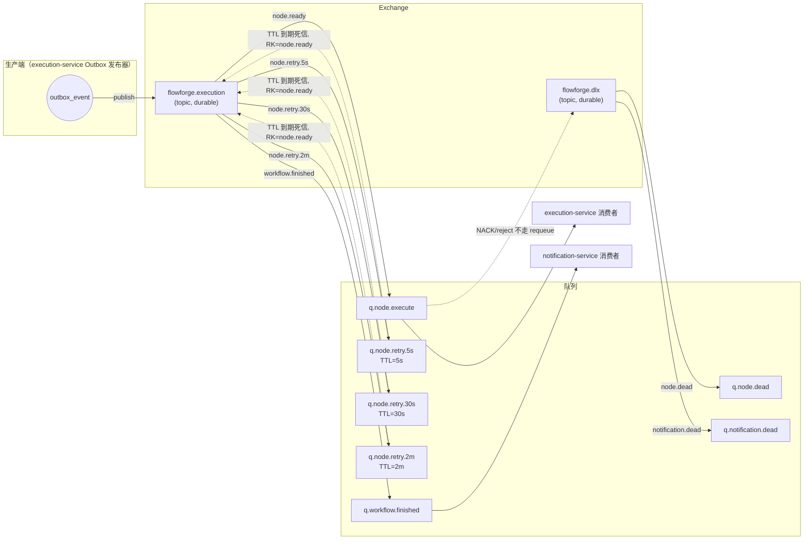

# 05 消息设计与可靠性

## 1. RabbitMQ 拓扑



| 队列 | 路由键 | 消费者 | 说明 |
| --- | --- | --- | --- |
| `q.node.execute` | `node.ready` | execution | 可执行节点任务 |
| `q.node.retry.5s` | `node.retry.5s` | 无（TTL 中继） | 5 秒后死信回 `node.ready` |
| `q.node.retry.30s` | `node.retry.30s` | 无 | 30 秒档 |
| `q.node.retry.2m` | `node.retry.2m` | 无 | 2 分钟档 |
| `q.workflow.finished` | `workflow.finished` | notification | 工作流终态 |
| `q.node.dead` | `node.dead` | 人工/后台任务 | 消息最终失败记录 |
| `q.notification.dead` | `notification.dead` | 人工 | 通知消费最终失败 |

全部队列与交换机 `durable=true`，消息 `delivery_mode=2`（持久化）。

**延迟重试为什么不用插件**：`rabbitmq_delayed_message_exchange` 需要额外安装插件，换环境就得重配。TTL + 死信是 RabbitMQ 原生能力，三个固定档位足以覆盖指数退避的前几档（5s → 30s → 2m），代价是延迟精度略粗——对任务重试完全可接受。

## 2. 消息结构

所有消息使用统一信封，`payload` 按事件类型区分。

```json
{
  "eventId": "5f0b2c7e-3b52-4a3f-9a1d-0f2c8e7d9a11",
  "eventType": "NODE_READY",
  "occurredAt": "2026-10-28T10:12:33.412+08:00",
  "traceId": "4bf92f3577b34da6a3ce929d0e0e4736",
  "executionId": 1024,
  "nodeExecutionId": 8801,
  "workflowVersion": 3,
  "payload": {
    "nodeKey": "node_2",
    "nodeType": "HTTP",
    "attemptNo": 1,
    "deadlineAt": "2026-10-28T10:13:33.000+08:00"
  }
}
```

| 字段 | 用途 |
| --- | --- |
| `eventId` | 全局唯一（UUID v4），消费端幂等的第一依据 |
| `eventType` | `NODE_READY` / `WORKFLOW_FINISHED` / `NODE_FAILED_PERMANENTLY` |
| `traceId` | 跨服务链路串联 |
| `executionId` / `nodeExecutionId` | 消费端直接定位记录，不靠业务字段反查 |
| `workflowVersion` | 消费端可校验版本绑定是否一致 |
| `occurredAt` | 排查延迟与乱序 |

**消息体禁止携带**：密码、JWT、完整请求头、未脱敏的响应体。节点配置中的 URL 与请求体在进入消息前由 `SensitiveDataMasker` 处理，Query 参数中的 token 类参数一律替换为 `***`。

## 3. 生产端：Transactional Outbox

### 3.1 事务边界

```java
@Transactional
public void advanceAfterNodeFinished(NodeExecution node) {
    // 1. 节点置终态（条件更新）
    nodeMapper.markSuccess(node.getId(), node.getVersion());

    // 2. 重算可达性、推进后继节点（同一事务）
    executionAdvancer.advance(node.getExecutionId());

    // 3. 写 Outbox（同一事务）
    outboxWriter.append(OutboxEvent.nodeReady(...));

    // 4. 若实例终结，追加一条 WORKFLOW_FINISHED
}
```

业务数据与 Outbox 记录同库同事务，**要么都成功，要么都回滚**。这是整个可靠性设计的基石。

### 3.2 发布器

```
每 200ms：
  SELECT * FROM outbox_event
   WHERE status = 'PENDING' AND (next_retry_at IS NULL OR next_retry_at <= NOW(3))
   ORDER BY id LIMIT 100
  FOR UPDATE SKIP LOCKED

  逐条 publish → 等待 Publisher Confirm
    ack   → status = 'SENT', sent_at = NOW()
    nack / 超时 → retry_count++, next_retry_at = 退避时间, last_error = ...
  超过 10 次 → status = 'FAILED'，写入告警日志
```

要点：

- `FOR UPDATE SKIP LOCKED` 让多个发布器实例互不阻塞，各自领取不同事件；**不需要分布式锁**。
- 使用 `CorrelationData` 携带 `eventId`，在 Confirm 回调里定位要更新的行。
- Publisher Confirm 是**异步**的：发布器不能"发送后立刻标记 SENT"，必须等回调；回调丢失（进程崩溃）时事件仍是 `PENDING`，下一轮会重发——宁可重复，不可丢失。
- 开启 `publisher-returns` 并把 mandatory 设为 true，处理消息无法路由的情况（例如队列被误删），此时 Confirm 可能仍返回 ack，但 Return 回调会触发，应把事件标记为需要重试并告警。

### 3.3 崩溃场景覆盖

| 崩溃点 | 结果 |
| --- | --- |
| 事务提交前崩溃 | 业务与 Outbox 一起回滚，无损 |
| 事务提交后、发布前崩溃 | Outbox 为 `PENDING`，发布器下一轮补发 |
| 发布成功、标记 SENT 前崩溃 | 事件仍为 `PENDING`，重复发布一次；消费端幂等吸收 |
| 标记 SENT 后、处理下一条前崩溃 | 已发送事件不受影响 |

**Outbox 提供的是"可恢复的至少一次投递"，不是精确一次**。永远不要在这套方案上假设消息不会重复。

## 4. 消费端：幂等与 ACK

### 4.1 幂等策略

| 事件 | 幂等手段 |
| --- | --- |
| `NODE_READY` | `UPDATE node_execution SET status='RUNNING' WHERE id=? AND status='READY'`，影响 0 行即放弃 |
| `WORKFLOW_FINISHED` | `INSERT ... ON DUPLICATE KEY` 依赖 `notification_record.uk_source_event` |
| 延迟重试消息 | 同 `NODE_READY`，状态条件更新天然去重 |

列表中的每一条都**不依赖"这条消息只会来一次"**。这是必须守住的底线。

### 4.2 ACK 时机

- **手动 ACK**：`acknowledge-mode: manual`。
- 业务处理并提交事务**之后**才 ACK。先 ACK 后处理的写法会在处理失败时永久丢消息。
- 处理过程中进程崩溃 → 消息未 ACK → RabbitMQ 在连接断开后重新入队 → 重复投递 → 由幂等吸收。

### 4.3 异常分类与处置

| 情况 | 处置 |
| --- | --- |
| 消息无法反序列化 / 缺少必填字段 | 记录死信表，ACK 丢弃（毒消息不阻塞队列） |
| 状态条件更新影响 0 行 | ACK（已处理或状态不符，属于正常幂等场景） |
| 数据库暂时不可用、连接池耗尽 | 按消息级重试投递到延迟队列，原消息 ACK |
| 业务永久性错误（节点配置非法） | 节点置 FAILED，ACK |
| 重试次数超过 `maxRetry` | 投递 `q.node.dead`，记录死信表，ACK |

**禁止 `basicNack(requeue=true)`**：数据库抖动时会让同一条消息在队列里无限循环，占满消费线程并打爆日志。重试必须经过延迟队列，有次数上限。

## 5. 两层重试的区分

这是本项目最容易混淆的地方，必须分清：

| 层级 | 触发者 | 状态载体 | 适用场景 |
| --- | --- | --- | --- |
| **节点级重试** | 节点执行失败（HTTP 5xx、连接失败） | `node_execution.status = RETRY_WAIT` + `next_retry_at` | 外部依赖的瞬时故障 |
| **消息级重试** | 消费消息本身出问题（DB 不可用） | 消息头 `x-retry-count` + 延迟队列 | 基础设施抖动 |

节点级重试由**重试扫描器**驱动：每 500ms 扫 `status='RETRY_WAIT' AND next_retry_at <= NOW()`，条件更新为 `READY` 后写 Outbox 投递。这样即使延迟消息丢失，扫描器也能把状态捡回来——**数据库才是事实来源**。

延迟队列在这里是"加速器"而不是"唯一路径"：消息丢了，扫描器兜底；消息重复，条件更新吸收。

## 6. 死信与失败记录

```sql
CREATE TABLE dead_letter_record (
  id           BIGINT UNSIGNED NOT NULL AUTO_INCREMENT,
  event_id     CHAR(36)     NOT NULL,
  event_type   VARCHAR(64)  NOT NULL,
  source_queue VARCHAR(64)  NOT NULL,
  execution_id BIGINT UNSIGNED DEFAULT NULL,
  payload      JSON         DEFAULT NULL COMMENT '脱敏后',
  reason       VARCHAR(512) NOT NULL,
  status       VARCHAR(16)  NOT NULL DEFAULT 'PENDING' COMMENT 'PENDING / RESOLVED',
  created_at   DATETIME(3)  NOT NULL DEFAULT CURRENT_TIMESTAMP(3),
  resolved_at  DATETIME(3)  DEFAULT NULL,
  PRIMARY KEY (id),
  UNIQUE KEY uk_event_id (event_id),
  KEY idx_status_created (status, created_at)
) ENGINE=InnoDB DEFAULT CHARSET=utf8mb4 COLLATE=utf8mb4_0900_ai_ci;
```

- 进入死信的消息**不会静默消失**，用户在"执行详情"里能看到"消息处理失败"记录。
- `uk_event_id` 保证同一条消息多次进入死信只留一条。
- 第一版不做自动重放，提供列表查询 + 手动触发接口（管理员），重放时重新生成 `eventId` 会破坏幂等，因此重放沿用原 `eventId`。

## 7. 关键配置

| 配置 | 值 | 原因 |
| --- | --- | --- |
| `spring.rabbitmq.publisher-confirm-type` | `correlated` | 需要拿到确认结果做状态更新 |
| `spring.rabbitmq.publisher-returns` | `true` | 捕获无法路由的消息 |
| `spring.rabbitmq.template.mandatory` | `true` | 同上 |
| `spring.rabbitmq.listener.simple.acknowledge-mode` | `manual` | 处理完再 ACK |
| `spring.rabbitmq.listener.simple.prefetch` | `10` | 限制单消费者未确认消息数 |
| `spring.rabbitmq.listener.simple.concurrency` | `4`（min 2 / max 8） | 与节点并发度匹配 |
| `spring.rabbitmq.listener.simple.retry.enabled` | `false` | 禁用 Spring 内置重试，重试由延迟队列与状态机接管 |
| 队列 `x-message-ttl` | 档位对应值 | 延迟重试 |
| 队列 `x-dead-letter-exchange` | `flowforge.execution` | TTL 到期回流 |
| 队列 `x-max-length` | 不设 | 由业务量控制 |

`retry.enabled=false` 是刻意为之：Spring 内置重试在监听器内部原地重试，会阻塞消费线程，且失败后仍会走 requeue，与我们的延迟队列策略冲突。
