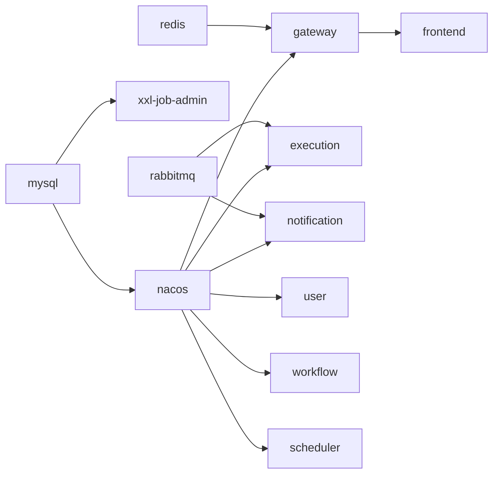

# 13 部署与运维

## 1. 两种运行方式

| 模式 | 适用场景 | 应用跑在哪 | 命令 |
| --- | --- | --- | --- |
| **本地开发** | 改代码、断点调试 | 宿主机 IDE / `java -jar` | `docker compose up -d`（只起基础设施） |
| **全栈容器** | 演示、验收、"从零启动" | 容器 | `./scripts/deploy.sh` |

两种模式连的是同一批基础设施容器，只是应用进程的位置不同。

## 2. 前置条件

| 依赖 | 版本 | 说明 |
| --- | --- | --- |
| JDK | 21 | 本地开发需要；仅跑容器时不需要 |
| Maven | 3.9+ | 已提供 `mvnw`，无需单独安装 |
| Node.js | 20+ | 仅前端构建需要 |
| Docker | 24+ | 需要 Compose v2 |

## 3. 一键部署

```bash
./scripts/deploy.sh
```

脚本做三件事：

1. `mvn clean package` —— 后端打包（容器镜像只装 JRE + jar）
2. `npm ci && npm run build` —— 前端产出 `dist`
3. `docker compose --profile app up -d --build` —— 构建镜像并启动全栈

已有构建产物时可跳过前两步：

```bash
./scripts/deploy.sh --skip-build
```

停止：

```bash
./scripts/stop.sh          # 保留数据
./scripts/stop.sh --purge  # 连同数据卷一起删除，下次启动会重新建表
```

## 4. 访问入口

| 入口 | 地址 | 说明 |
| --- | --- | --- |
| **前端** | http://localhost:8088 | 唯一对外入口，`/api` 由 Nginx 反代到网关 |
| Nacos 控制台 | http://localhost:8849 | 首次访问按引导初始化管理员 |
| XXL-JOB 调度中心 | http://localhost:8090/xxl-job-admin | `admin` / `123456` |
| RabbitMQ 控制台 | http://localhost:15674 | `flowforge` / `flowforge` |

应用服务之间只走 compose 内部网络，**不对外映射端口**——与生产拓扑一致。

## 5. 启动顺序与等待



`depends_on` + healthcheck 保证「基础设施健康 → 业务服务 → 网关 → 前端」。
即便如此，**服务注册到 Nacos 仍需要 30~60 秒**，刚启动就访问前端可能看到 503，
稍等重试即可。

## 6. 关键配置

| 配置 | 环境变量 | 默认值 | 说明 |
| --- | --- | --- | --- |
| JWT 密钥 | `FLOWFORGE_JWT_SECRET` | compose 内置开发值 | 所有服务必须一致，长度 ≥ 32 字节 |
| MySQL | `MYSQL_HOST` / `MYSQL_PORT` | `127.0.0.1:3307` / `mysql:3306` | local / docker 两套 |
| RabbitMQ | `RABBITMQ_HOST` / `RABBITMQ_PORT` | `127.0.0.1:5674` / `rabbitmq:5672` | |
| Nacos | `NACOS_SERVER_ADDR` | `127.0.0.1:8848` / `nacos:8848` | 服务发现与配置中心共用同一地址 |
| Nacos 账号 | `NACOS_USERNAME` / `NACOS_PASSWORD` | 空 | 本地关闭鉴权时留空即不登录；开启鉴权后必须注入 |
| XXL-JOB 调度中心 | `XXL_JOB_ADMIN` | `http://127.0.0.1:8090/xxl-job-admin` | |

> 生产环境必须替换：JWT 密钥、数据库密码、Nacos 开启鉴权、XXL-JOB accessToken。

### 6.1 配置中心

六个服务都通过 `spring.config.import` 读取 Nacos，dataId 固定为
`flowforge-common.yaml`（共享）与 `flowforge-<服务名>.yaml`（私有），分组 `FLOWFORGE`。

| 项 | 说明 |
| --- | --- |
| 是否必需 | **非必需**。import 带 `optional:` 前缀，Nacos 里没有配置时服务照常启动，用本地 yml 的默认值 |
| 写入初始配置 | `./scripts/init-nacos-config.sh`（本地关闭了管理端鉴权才能免 token 调用） |
| 只放什么 | 可热更新的运行参数：日志级别、网关限流阈值。**不放密钥、数据源、MQ 地址**——本地 Nacos 无鉴权，同网段谁都能读 |
| 前缀 | `spring.cloud.nacos.config.*`，不是 `spring.nacos.config.*`；后者的写法会被静默忽略 |
| 容器内地址 | `spring.config.import` 早于 profile 文档解析，所以 Nacos 地址靠 compose 的 `NACOS_SERVER_ADDR` 环境变量传入，`application-docker.yml` 里的同项不参与 import 解析 |
| 本地关闭鉴权 | 需要同时关 `NACOS_AUTH_ENABLE`、`NACOS_AUTH_ADMIN_ENABLE`、`NACOS_AUTH_CONSOLE_ENABLE`，三个开关互相独立 |

能热更新的只有真正会被重新绑定的项：

| 配置 | 热更新 | 原因 |
| --- | --- | --- |
| `logging.level.*` | ✅ | `LoggingRebinder` 监听环境变更直接改日志级别 |
| `flowforge.gateway.rate-limit.*` | ✅ | `ConfigurationPropertiesRebinder` 原地重绑，过滤器每次请求都读该对象 |
| `@Scheduled` 的 `fixedDelayString` | ❌ | 只在 bean 初始化时解析一次，改配置必须重启 |

## 7. 数据库初始化

`deploy/mysql/init/` 下的脚本按文件名顺序执行，**只在数据卷为空时运行一次**：

| 文件 | 内容 |
| --- | --- |
| `01-databases.sql` | 建库与账号授权 |
| `02-user-schema.sql` | 用户、角色 |
| `03-workflow-schema.sql` | 工作流定义、版本、节点、边 |
| `04-execution-schema.sql` | 执行实例、节点、尝试、事件、Outbox、死信 |
| `05-scheduler-schema.sql` | 周期任务与调度记录 |
| `06-notification-schema.sql` | 通知与投递记录 |

改了建表脚本后必须：

```bash
./scripts/stop.sh --purge
./scripts/deploy.sh
```

**XXL-JOB 的表不在这批脚本里**（它属于调度中心自己的库），首次部署需要手工初始化一次：

```bash
docker exec -i flowforge-mysql mysql -uroot -proot < path/to/tables_xxl_job.sql
```

## 8. 常用运维命令

```bash
cd deploy

# 查看全栈状态
docker compose --profile app ps

# 跟踪某个服务的日志
docker compose --profile app logs -f flowforge-execution-service

# 只看错误
docker compose --profile app logs flowforge-execution-service | grep ERROR

# 重启单个服务
docker compose --profile app restart flowforge-workflow-service

# 查看消息积压
docker exec flowforge-rabbitmq rabbitmqctl list_queues name messages

# 查看 Outbox 积压
docker exec flowforge-mysql mysql -uroot -proot -e \
  "SELECT status, COUNT(*) FROM flowforge_execution.outbox_event GROUP BY status;"

# 查看死信
docker exec flowforge-mysql mysql -uroot -proot -e \
  "SELECT id, event_type, reason, created_at FROM flowforge_execution.dead_letter_record ORDER BY id DESC LIMIT 10;"
```

## 9. 常见问题

| 现象 | 原因 | 处理 |
| --- | --- | --- |
| 前端 502/503 | 网关或下游还没注册到 Nacos | 等待 60 秒后刷新，`docker compose logs flowforge-gateway` |
| 单独重建网关后前端一直 502 | nginx 启动时把上游 IP 解析并缓存了，网关重建后 IP 变了 | `docker restart flowforge-frontend` |
| 登录 401 但密码正确 | 各服务 JWT 密钥不一致 | 检查 `FLOWFORGE_JWT_SECRET` 是否所有服务一致 |
| 工作流执行时 HTTP 节点失败 | 节点 URL 写的是 `127.0.0.1` | 容器内应使用 compose 服务名，如 `flowforge-user-service:8081` |
| 建表脚本改了没生效 | 初始化只在空数据卷时执行 | `./scripts/stop.sh --purge` 后重新部署 |
| 容器反复重启且 `exit 255` | Nacos 缺 `NACOS_AUTH_TOKEN` / `IDENTITY` | 见 compose 注释 |
| XXL-JOB 触发报 NPE | 任务是用 SQL 直接插的 | 必须通过 admin 界面/接口创建 |

## 10. 扩容说明

执行服务与调度服务设计上支持多实例：状态迁移全部走条件更新，
推进逻辑在实例行锁内完成，重复消息与并发扫描由唯一键吸收。

落地时的注意点：

- 执行服务多实例时，消费者并发数要按总吞吐重新分配 `spring.rabbitmq.listener.simple.concurrency`；
- 调度服务多实例时，XXL-JOB 用「故障转移」或「分片广播」路由，两遍都靠唯一键兜底；
- 网关限流的计数存在 Redis 里（key 按用户 / IP 划分），多实例共享同一份令牌桶，
  扩容后**总配额不变**，不需要按实例数折算；网关进程本身仍然无状态。

目前**未做真实多实例压测**，以上为设计层面的延伸说明。
